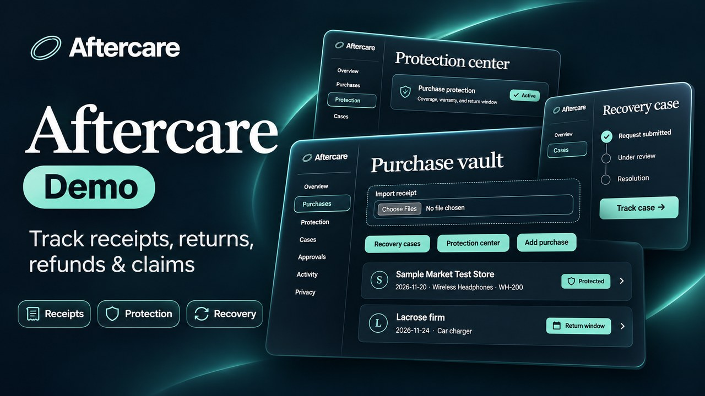
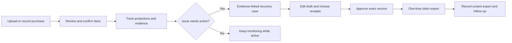
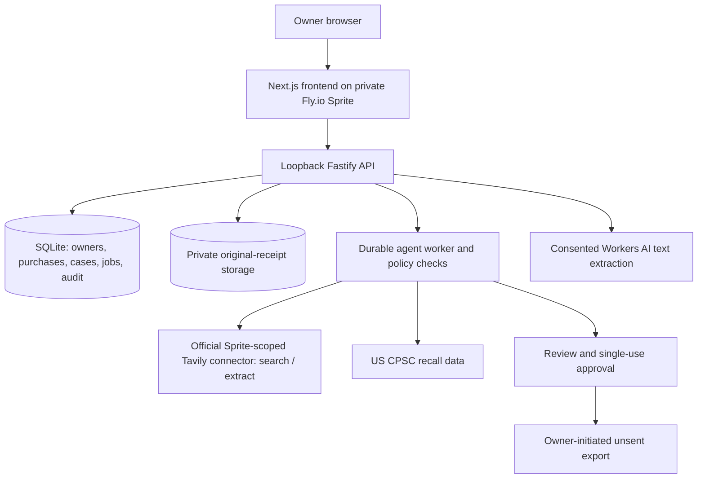

# Aftercare

**Your purchases deserve a second look.**

After checkout, receipts are scattered across inboxes, return deadlines slip by, warranty details disappear, and refund commitments are difficult to follow. **Aftercare** keeps purchases, evidence, protection checks, and recovery decisions together in a private journal—and helps turn an actionable issue into an evidence-backed claim the owner can review and export.



**Watch the 3:23 cinematic demo:** [Video (MP4)](docs/aftercare-demo.mp4) · [Illustrated walkthrough and timestamped transcript](docs/demo.md) · [English subtitles (WebVTT)](docs/aftercare-demo.vtt)

**Built for Fly.io Hacksgiving 2026** · Running on a private Fly.io Sprite · Official Sprite-scoped **Tavily** connector · Owner-approved actions · Synthetic demonstration data

> **Judging access:** The production journal remains private and admin-only. The film, transcript, code, and verification records are intended to be accessible when this repository is published. No login is required to review those materials.

## The problem and the approach

A receipt alone does not protect a purchase. The relevant return terms may live on a retailer's website; warranty coverage may be tied to one item; a recall may depend on a model or serial batch; an overdue delivery or refund may require correspondence and proof.

Aftercare combines a **durable purchase record**, **source-aware protection intelligence**, and a **controlled recovery workflow**. Its agent can evaluate recorded obligations and preserve follow-up work across service restarts. External information is tagged with sources, freshness and uncertainty rather than silently promoted to fact. A suggested claim cannot be dispatched as though it were approved or sent: the owner reviews the exact content and attachments, then explicitly authorizes an export.

## What the product does

| Capability | What the user can inspect or control |
|---|---|
| **Receipt vault** | Upload and keep original receipts; confirm editable extraction candidates; correct line items; attach more originals; tag, search and organize purchases |
| **Return and warranty protection** | Record source-backed policy evidence, calculate time windows, and review upcoming or elapsed deadlines |
| **Merchant-policy research** | Research policies using the official Tavily Sprite connector, with scope checks and source references; ambiguous applicability stays unverified |
| **Price opportunities** | Evaluate narrowly matched comparable offers by SKU, condition, merchant, currency and freshness; live comparable-offer verification is not yet established |
| **Product recalls** | Compare relevant product identifiers against US CPSC notices, including model/serial-specific evaluation where available |
| **Delivery and refund issues** | Record missed deliveries, refund promises, processing/disputed revisions, due dates and follow-ups without inventing courier or bank confirmations |
| **Recovery and claims** | Open evidence-linked cases, edit drafts, select original attachments, review redactions and recipients, and export TXT, JSON, PDF or an unsent email draft |
| **Private, auditable execution** | Owner-scoped sessions, source-linked history, durable jobs and retries, privacy controls, receipt integrity and single-use exact-version approval |

## See the complete journey



The [cinematic product film](docs/aftercare-demo.mp4) follows one **clearly synthetic** notebook purchase: receipt review and correction → saved purchase → return/warranty checks → missed-delivery case → versioned claim → attachment selection → approval and JSON download → `exported_not_sent` → rejected approval replay (`HTTP 409`) → refund dispute and follow-up.

The demo mixes actual local UI recordings with clearly labeled historical evidence for external integrations and Sprite recovery. It does not present simulated merchant activity as a live provider response.

## Real architecture and integrations



**Fly.io Sprites:** The private release was verified running a Fastify API, frontend, worker and persistent receipt storage. Authentication, original receipt bytes after a service restart, and operator-triggered recovery were checked. The journal API is restricted to loopback behind the frontend and the private edge restricts access.

**Official Tavily connector:** Search/extract were verified through a restricted Sprite grant. Retrieved sources are still subject to merchant/jurisdiction/applicability checks. A later release-specific lookup returned HTTP 200 but retained zero policy references; it is not evidence of a new positive policy match.

**Cloudflare Workers AI:** A consented plain-text receipt inference was observed; the suggested amount was incorrect and the owner corrected it before confirmation. This is intentional human oversight, not an accuracy guarantee. Merchant website extraction has local regression coverage only.

**CPSC:** Real notices were retrieved and source-linked, with documented model and serial-batch classification for notice 26-372. Generic name matches remain candidates, not definitive affected-unit confirmations.

**Important:** Independent *scheduled* wake of a cold private Sprite has **not been verified**. Work persists and catches up after wake, but the system should not be represented as guaranteeing unattended deadline-time wakeups.

[Architecture specification](docs/02-system-architecture.md) · [Approved decisions](docs/00-decisions.md) · [Deployment and operations](docs/10-deployment-operations.md) · [Live integration evidence](docs/evidence/M5.md)

## Trust model

- **Owner control:** Receipt extraction and external research require consent. Purchases, source documents, cases and approvals are owner-scoped.
- **Facts before actions:** Suggestions carry provenance and may be corrected; a merchant promise does not prove a refund arrived.
- **Exact-version approval:** An approval is bound to claim content and recipient and can be used once; editing requires new authorization.
- **Honest export status:** Downloading claim files records `exported_not_sent`. Aftercare does **not** claim to have emailed the merchant.
- **Original evidence:** Selected receipt originals are preserved as original bytes; text redaction does not silently modify original attachments.
- **Recovery safeguards:** Durable jobs, bounded retry behavior, audit records, integrity checks and explicit restart/restore procedures are documented. Historical snapshot rollback requires reconciliation before external effects resume.

[Security and privacy design](docs/06-security-privacy.md) · [Agent state machine](docs/04-agent-state-machine.md) · [Operational recovery](docs/10-deployment-operations.md)

## Verification snapshot

These are historical results from the accepted release—not claims that new tests ran during documentation preparation.

| Evidence | Reported / observed result |
|---|---|
| Owner acceptance | **24/24** checks passed, owner-reported |
| Application tests | **31/31** passed |
| Playwright browser tests | **20/20** passed |
| Production build | Passed |
| Private Sprite | Authenticated API and worker execution; receipt persistence across service restart |
| Connector and extraction | Earlier live Tavily search/extract and Workers AI text-receipt inference |
| Security workflow | Single-use approved claim export and replay rejection (`HTTP 409`) |

Release lineage: accepted application baseline `3128f7d`; private deployed revision `90f91c9`; cinematic film revision `a8be741`; documentation/privacy cleanup `8cb31e2`. See the [M0–M6 evidence index](docs/evidence/README.md), [M5 integration record](docs/evidence/M5.md), and [M6 release record](docs/evidence/M6.md).

## Run locally

**Requirements:** Node.js **24.22.1**, pnpm **9.15.9**; Google Chrome for the headed disposable acceptance session. From the repository root:

```bash
pnpm install --frozen-lockfile
pnpm dev
```

Open <http://127.0.0.1:3000/vault> to create an account (password at least 12 characters) or sign in. The launcher starts Next.js on port 3000 and the Fastify API on loopback port 3101. SQLite is created/migrated automatically. Account records persist at `apps/api/aftercare.sqlite`, with default private uploads at `apps/api/private-uploads/`. Shut down with Ctrl-C; restart after API source changes. No environment variables are required for the standard launcher.

For the separate, read-only demonstration journal, set a private `DEMO_SECRET` of at least 32 characters before startup; the Basic username is `demo`. The default development launcher otherwise creates a temporary secret. `SQLITE_PATH` and `PRIVATE_UPLOAD_DIR` accept absolute paths; keep custom storage outside tracked project paths.

If starting the services separately, export `DEMO_SECRET`, run `APP_BASE_URL=http://127.0.0.1:3000 pnpm --filter @aftercare/api start` from the repository root, and start Next.js with `pnpm --filter @aftercare/web dev --webpack --hostname 127.0.0.1 --port 3000`. Keep both ports available. See [safe local port troubleshooting](docs/10-deployment-operations.md#local-port-troubleshooting).

### Existing local owner profile

If you already have accounts created during the earlier M2 local work, stop the default launcher and run `pnpm dev --m2-data`, then open <http://127.0.0.1:3120/vault>. This selects the legacy data profile, not a different product release. A fresh clone normally uses `pnpm dev`.

### Try the synthetic acceptance journey

```bash
pnpm acceptance
```

A headed Chrome/Playwright session opens a **separate disposable SQLite database and receipt directory**, with a synthetic account and purchase. It is isolated from normal local accounts. See the [owner acceptance walkthrough](docs/owner-acceptance.md). Use **Resume** in Playwright Inspector to finish and reset by running the command again.

## Known limitations and scope

- **Private deployment:** The live journal is owner/admin restricted. The public submission consists of code, the video and supporting documentation rather than an anonymous production login.
- **Cold wake:** Independent scheduled wake of an inactive private Sprite remains unverified; overdue work catches up after a wake.
- **Receipt extraction:** Plain-text AI assistance was live verified. On supported macOS environments, Swift/Apple Vision helps with PDF and image extraction; the deployed Linux Sprite requires manual review for image/PDF receipts. PDF extraction is limited to 12 pages / 8,000 characters where supported.
- **Price and refund claims:** No verified live comparable-price feed or trusted provider-confirmed settlement integration. Owner-reported status is labeled accordingly.
- **Claim delivery:** Authorized claims can be exported in multiple formats. Downloads are **not** merchant sends, and external resolution requires supporting evidence.
- **CPSC coverage:** US-oriented official sources; ambiguous products and identifiers require further verification.

## Documentation

[Product requirements](docs/01-product-requirements.md) · [Architecture](docs/02-system-architecture.md) · [API contracts](docs/05-api-contracts.md) · [UI and design system](docs/07-ui-ux-design-system.md) · [Testing strategy](docs/08-test-strategy.md) · [Deployment operations](docs/10-deployment-operations.md) · [Demo/submission](docs/12-demo-and-submission.md) · [Evidence index](docs/evidence/README.md) · [Release checklist](docs/evidence/M6.md)

---

*Aftercare is an evidence-driven personal protection agent. It supports human decisions; it does not fabricate policy rights, payment confirmations or sent communications.*
