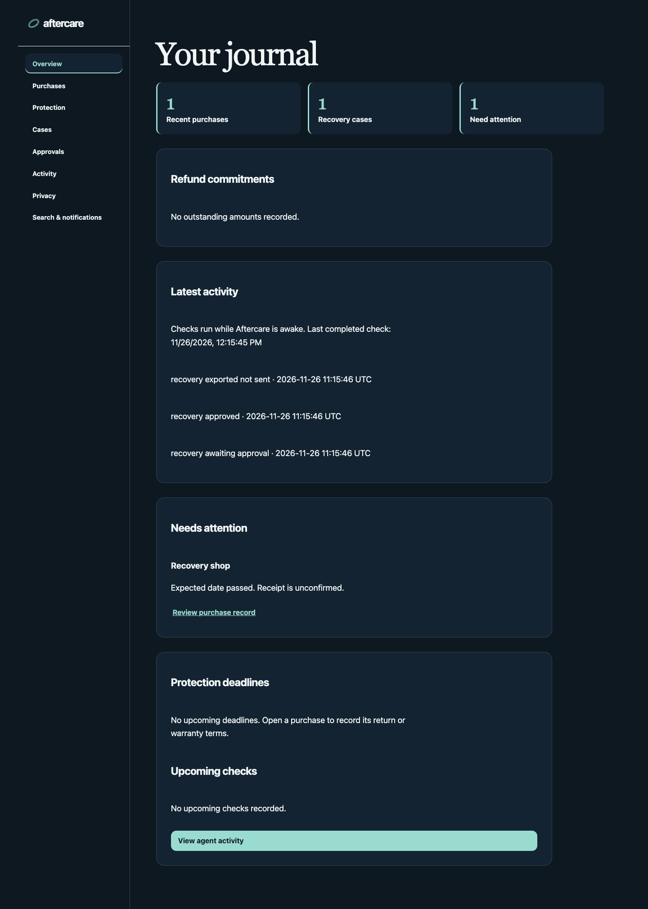

# Aftercare from receipt to recovery

Synthetic walkthrough • Willow Stationery • USD 12.45

**1. Keep the original.** A notebook never arrives. Its owner confirms the purchase in Aftercare and keeps the original receipt and packing slip with the record. Receipt suggestions stay editable until confirmation.

**2. Follow the promise.** The synthetic shop promised a refund. Its status changed from processing to disputed, and its due date passed. The journal keeps each source and shows that receipt of the money still needs confirmation.

*Example overview from the local browser regression suite. The figures in the screenshot belong to its separate test fixture.*

**3. Approve one claim.** The owner reviews the delivery case, intended recipient, letter and one selected original receipt. The download contains the approved letter and original bytes. Trying the same authorization again returns HTTP 409. The activity record says exported, with delivery unconfirmed.

**4. Return to the case.** The local worker records a follow-up when the disposable refund deadline comes due. Pending work survives restart. An independent wake of a sleeping private Sprite still needs verification.

The real app can replay this story locally using the [private acceptance journal](owner-acceptance.md). The published walkthrough needs no login or owner narration once its repository is shared.

## Film and transcript

[Watch or download the 2:24 film](aftercare-demo.mp4) · [English WebVTT](aftercare-demo.vtt). The score is an original synthesized instrumental composed for this film. There is no speech or sampled recording. Historical integration results are identified on screen.

**0:00 — A promise slips.** A receipt is filed away. A delivery goes missing. A promised refund never arrives. Willow Stationery is a synthetic purchase.

**0:09 — Read the receipt.** Upload a text receipt and review the suggested fields. In a verified Workers AI run, a €12.45 item was predicted as 12 minor units.

**0:18 — Correct the record.** The owner corrects the amount to 1245 and confirms the purchase. The original stays attached to the vault record.

**0:27 — Keep the deadline.** A return window can end on a stated date. A warranty can run for calendar months. Aftercare keeps the policy time zone and labels elapsed-day estimates.

**0:36 — Read the policy.** A private Sprite used the official Tavily gateway to search and extract REI policy pages. Applicability still needs review. The release lookup retained zero references.

**0:45 — Compare carefully.** A lower price needs the same SKU, condition and seller, plus applicable adjustment terms. Comparable-price rules passed locally. A live qualifying offer remains unverified.

**0:54 — Identify the unit.** CPSC notice 26-372 identifies Wybot Osprey 700 Max serial batches. A product name alone stays a candidate. A matching unit needs serial evidence.

**1:03 — A delivery is overdue.** The local worker detects the missed synthetic delivery. The protection assessment links the issue back to the purchase and its evidence.

**1:12 — Prepare the claim.** Review the proposed letter and exact recipient. Select which original receipt to include. Redacting letter text leaves receipt bytes unchanged.

**1:21 — Approve one version.** The owner approves the reviewed draft, including its recipient, body, redactions and selected attachment identity.

**1:30 — Download once.** A real JSON claim package downloads. The acceptance regression replayed the same authorization and received HTTP 409. The claim is exported, unsent.

**1:39 — Follow the refund.** The overdue $12.45 refund moved from processing to disputed. Prior sources remain visible. Receipt of funds is unconfirmed.

**1:48 — Pick up the thread.** The local worker posts a due follow-up. The inbox shows the reminder and Activity retains the recovery history. Only the synthetic due time was advanced.

**1:57 — Recover after wake.** On the private Sprite, the restarted journal retrieved the purchase and identical receipt bytes. Independent scheduled wake of a cold private Sprite remains unverified.

**2:06 — What passed.** The owner completed all 24 local checks. All 31 application tests and 20 browser tests passed. The production build passed.

**2:15 — Aftercare** A private record from receipt to recovery. Verified integrations include Fly.io Sprites, official Tavily search and extraction, and Workers AI text-receipt inference.
